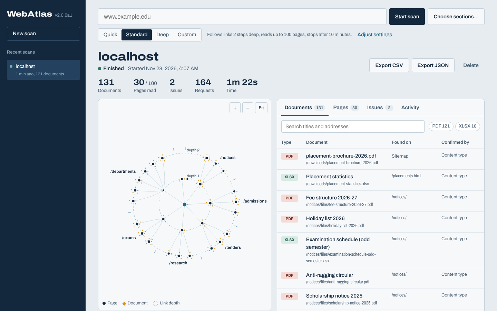

# WebAtlas 🕸️

**A self-hosted crawler that finds every public document on a website and maps it as a knowledge graph.**

Point it at a college, school or company site. WebAtlas reads its `robots.txt` and sitemap, crawls the
site breadth-first, and records every PDF, Word, Excel, PowerPoint and archive file it links to, with the
page it was found on. No paid APIs, no API keys.

> **Status: v2 in progress.** This branch replaces the Bright Data hackathon version with a crawler
> WebAtlas owns end to end. See the [roadmap](#roadmap) for what's next.

---

## What's new in v2 (Phase 1)

| | v1 (hackathon) | v2 |
|---|---|---|
| Fetching pages | Bright Data Scraper Studio (paid, trial ended) | Own async crawler (`httpx`) |
| Finding pages | AI-generated collector per domain | `robots.txt` + `sitemap.xml` + breadth-first crawl |
| Following links | Selected pages only (`max_depth=0`) | Configurable depth and page budget |
| Spotting documents | File extension only | Extension, `Content-Type`, `Content-Disposition` and magic bytes |
| JavaScript sites | Handled by Bright Data | Optional headless-browser fallback (Playwright) |
| Security | User URL passed to a shell command | SSRF guard on every request and redirect, no shell calls, UI output escaped |
| Interfaces | Web UI | Scan console with a live site map, history and export, plus a `webatlas` CLI |
| Tests | None | 107 tests against a fake website (no network needed), plus a live-site workflow |

## How it works

```
seed URL
  │
  ├─ SSRF guard ─────── refuse localhost, private and cloud-metadata addresses (every redirect hop too)
  ├─ robots.txt ─────── skip disallowed paths, honour Crawl-delay
  ├─ sitemap.xml ────── add pages no menu links to (gzip and sitemap indexes supported)
  ▼
priority queue (breadth-first, documents first)
  │
  ├─ page ──► fetch HTML ──► extract links ──► same-site pages  → queue (until max depth)
  │                                       └──► document links   → queue as "doc"
  │          (if the "page" is really a file, e.g. /download.php?id=5 → record it as a document)
  │
  └─ doc  ──► HEAD (or first 4 KB) ──► confirm by Content-Type / filename / magic bytes ──► record
  ▼
Domain → Page → Document graph (SQLite) ──► interactive graph UI
```

Politeness is built in: a per-host delay, a small number of concurrent requests, retries with backoff
that respect `Retry-After`, and size limits on every download.

## Quick start

```bash
git clone https://github.com/umang3307/WebAtlas.git
cd WebAtlas
pip install -e .
webatlas ui
```

That opens the scan console at `http://127.0.0.1:5000`. Requires Python 3.11.5 or newer.

For a verified install, where every dependency is pinned and checked against a known hash, use the lock file:

```bash
pip install --require-hashes -r requirements.lock
pip install --no-deps -e .
```



### The scan console

- **Start a scan** from an address, or click **Choose sections…** to pick which parts of the site to start from.
- **Pick a size:** Quick, Standard or Deep, or adjust depth, page limit, time limit, request delay and more.
  Tick **No limit** on depth, pages, time or file confirmation for a full crawl; the console warns you
  first, and Stop always keeps what was found.
- **Watch it live.** The map places the start page at the centre and pages on rings by link depth, one slice per
  site section; documents appear around the page that links to them. Click a page to see only its files.
- **Explore the results:** search, filter by file type, see where each file was found and how it was confirmed,
  and check the Issues tab for pages that failed or were skipped because of robots.txt.
- **Stop** a scan at any time and keep what it found. **Export** to CSV or JSON. Past scans are saved in
  `webatlas.db` and listed in the sidebar.

The console only listens on `127.0.0.1`, rejects requests addressed to other host names (DNS rebinding),
accepts only JSON for actions (CSRF), sends a strict Content-Security-Policy, and shows text from crawled
sites strictly as text.

### Command line

```bash
webatlas crawl https://www.example.edu --depth 2 --max-pages 200 --max-time 300 --out results.json
```

Useful options: `--download` (hash documents with SHA-256 and drop duplicates), `--render` (headless browser
for JavaScript-only pages), `--no-sitemap`, `--no-subdomains`, `--delay 1.0`, `--doc-checks 500`.
Run `webatlas crawl --help` for all.

### Limits

The defaults (depth 2, 100 pages, 1,000 confirmed files) keep an accidental scan of a huge site short.
Every one of them can be lifted: pass `0` for `--max-pages`, `--max-time` or `--doc-checks`, or use
`--unlimited` to lift them all, including depth. Press Ctrl+C once to stop and keep the results.
Politeness settings (delay per host, parallel requests, robots.txt) always apply, and crawler traps such as
endlessly repeating paths are skipped automatically.

### JavaScript-heavy sites (optional)

```bash
pip install -e ".[render]"
playwright install chromium
webatlas crawl https://www.example.edu --render
```

## Development

```bash
pip install -e ".[dev]"
pytest          # runs against a fake website, no network access needed
ruff check .
```

To try the crawler on a site running on your own machine, pass `--allow-private` to the CLI or set
`WEBATLAS_ALLOW_PRIVATE=1` before `webatlas ui`. Both are off by default.

### Dependencies

WebAtlas depends only on free, widely used open-source libraries and needs no API keys or paid services.
`requirements.lock` pins every package to an exact version and hash, using only releases at least a week
old. CI installs from it, runs `pip-audit` on it, and Dependabot reports new vulnerabilities. To update it:

```bash
uv pip compile pyproject.toml --universal --python-version 3.11.5 --generate-hashes \
  --exclude-newer "$(date -u -d '7 days ago' +%Y-%m-%dT%H:%M:%SZ)" -o requirements.lock
```

## Responsible use

Only scan sites you are allowed to scan. WebAtlas respects `robots.txt` and rate-limits itself by default;
keep it that way when crawling sites you don't own.

## Roadmap

- [x] **Phase 1:** own crawler: robots.txt, sitemaps, document detection, SSRF guard, CLI, tests
- [x] **Scan console:** live site map, scan settings, history, stop, CSV/JSON export
- [ ] **Phase 2:** FastAPI backend, resumable background jobs, live progress (SSE), SQLAlchemy storage
- [ ] **Phase 3:** document analysis: metadata leaks (authors, software, internal paths), emails, secrets
- [ ] **Phase 4:** AI layer: local-LLM link prioritisation, document classification, RAG Q&A with citations
- [ ] **Phase 5:** Docker Compose, benchmarks, demo

## History

v1 was built in August 2026 for [Into the Scrape-Verse](https://www.wemakedevs.org/hackathons/scrape-verse),
the Bright Data Scraper Studio hackathon, by team **Sunflowers** (Umang Agarwal and Aashvi Pandey). It used
Bright Data's automated collectors and their heal API. That version is preserved on the `main` branch.
